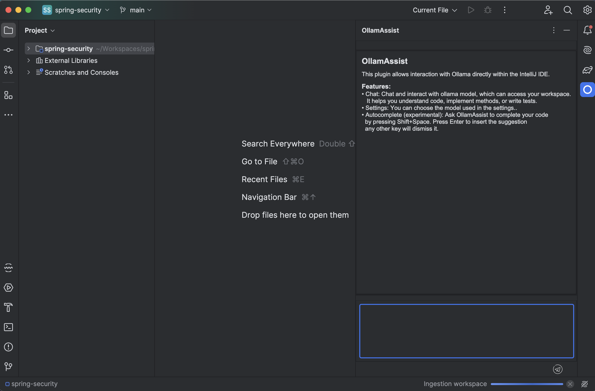
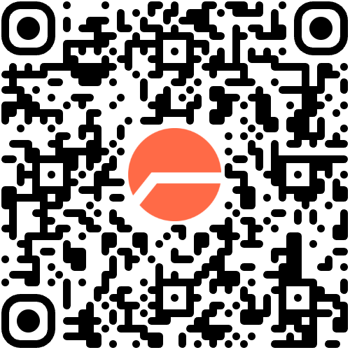
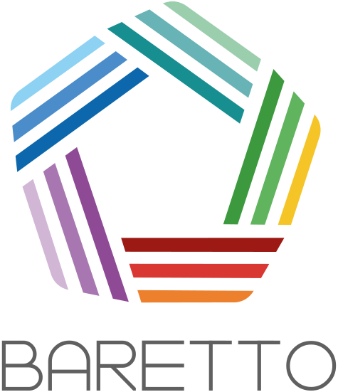

<div v-click class="abs-tr mt-14 mr-16 coup-de-tampon">
  <Tampon :angle="10">Copie à corriger</Tampon>
</div>

# RAGots et <span class="rouge">Hallucinations</span>

<p class="sous-titre">votre chatbot <span class="entoure">passe devant le juge</span></p>

<p class="mt-10 flex items-center">
  <a href="https://fr.linkedin.com/in/melketroussi" target="_blank" class="inline-flex items-center gap-2">
    <carbon:logo-linkedin class="text-2xl" /> Mehdi Elketroussi
  </a>
  <span class="mx-3 text-gray-400">·</span>
  <a href="https://www.baretto.fr" target="_blank" class="inline-flex items-center gap-2">
     Baretto
  </a>
</p>

<div class="abs-bl ml-18 mb-10">
  <span class="etiquette-logo">
    
    DevFest Paris · 27 novembre 2026
  </span>
</div>

<!--
⏱ 0:30 (0:30). Cible : 18 min max.
- Bonsoir, je m'appelle Mehdi Elketroussi, software engineer chez Baretto.
- Un assistant de code : comment savoir s'il s'améliore ? Aujourd'hui : comment on juge le juge.
- [click] Tampon. 1 s de silence.
-->

---
transition: fade-out
---
# Jake Moffatt, 2022

<div class="scotch mx-auto w-[92%]">
  
</div>

<p class="ref text-right mt-3">« The Long Lonely Wait », Anne Worner, CC BY-SA 2.0</p>

<!--
⏱ 0:35 (1:05)
- Jake Moffatt, 2022. Un deuil, un voyage en urgence.
- Le chatbot : « partez, demandez le tarif réduit au retour ».
- Au retour : « c'était une erreur du chatbot ».
-->

---
transition: fade-out
---
# Un chatbot n'est pas un POC

Air Canada plaide : le chatbot est
**« une entité juridique distincte, responsable de ses propres actes »**.

<div v-click>

Le tribunal :

> « This is a remarkable submission. While a chatbot has an interactive
> component, it is still just a part of Air Canada's website. »

<span class="ref">Moffatt v. Air Canada, 2024 BCCRT 149</span>

</div>

<div v-click class="abs-br mb-20 mr-20 coup-de-tampon">
  <Tampon :angle="-10">650,88 $ CA</Tampon>
</div>

<!--
⏱ 0:55 (2:00)
- Air Canada : « le chatbot est responsable de ses actes ».
- [click] Le tribunal : il fait partie du site. (laisser lire)
- [click] 650,88 $. (laisser le tampon) Un chatbot n'est pas un POC.
- Mains levées : qui a un LLM en prod ? (2 s) Qui l'évalue ? (2 s, un mot de réaction)
-->

---
transition: fade-out
---
# Même un expert n'a rien vu

<div class="scotch extrait mx-auto mt-8">
  <span class="source">Autre affaire · un avocat, New York, 2023</span>
  <ol class="citations">
    <li>Affaire <b>Varghese</b> <span>2019</span></li>
    <li>Affaire <b>Shaboon</b> <span>2013</span></li>
    <li>Affaire <b>Petersen</b> <span>2012</span></li>
    <li>Affaire <b>Martinez</b> <span>2019</span></li>
    <li>Affaire <b>Durden</b> <span>2017</span></li>
    <li>Affaire <b>Miller</b> <span>1999</span></li>
  </ol>
  <div v-click="1" class="tampon-faux coup-de-tampon"><Tampon :angle="-9" taille="1.5rem">Aucun n'existe</Tampon></div>
</div>

<p v-click="1" class="text-center mt-4"><span class="ref">Mata v. Avianca, S.D.N.Y., 22-cv-1461, juge P. Kevin Castel, 22 juin 2023</span></p>

<p v-click="2" class="text-center" style="margin-top: 1.5rem"><span class="entoure font-bold">Avec un LLM, le faux a exactement la forme du vrai.</span></p>

<style>
.extrait { position: relative; width: 640px; padding: 1.1rem 2rem; }
.extrait .source {
  font-family: 'JetBrains Mono', monospace; font-size: 0.75rem;
  letter-spacing: 0.05em; color: var(--encre-douce);
}
.extrait .citations { list-style: decimal; padding-left: 1.6rem; margin: 0.8rem 0 0; font-size: 1.35rem; line-height: 1.6; }
.extrait .citations li { margin: 0; padding-left: 0.3rem; }
.extrait .citations li::marker { color: var(--encre-douce); font-size: 1rem; }
.extrait .citations span { font-family: 'JetBrains Mono', monospace; font-size: 0.9rem; color: var(--encre-douce); margin-left: 0.5rem; }
.tampon-faux { position: absolute; right: -2rem; bottom: -0.6rem; }
</style>

<!--
⏱ 1:00 (3:00)
- Autre affaire, New York, 2023 : un avocat dépose ce mémoire. Tout a l'air juste.
- [click] Six jugements, tous inventés par ChatGPT. L'avocat paie 5 000 dollars.
- Test unitaire, comparaison mot à mot : ils ne voient rien.
- [click] « Avec un LLM, le faux a exactement la forme du vrai. »
-->
---
transition: fade-out
---
# OllamAssist
<div class="carte">
<div class="texte">

**Un assistant de code dans IntelliJ,
entièrement local. Mon labo.**

<p v-click>D’abord un <strong>chatbot</strong> : il répond avec ce qu’il sait.</p>

<p v-click>Puis un <strong>agent</strong> : il lit mon workspace,
et répond sur <strong>mon</strong> code.</p>

<p v-click><strong>Sa réponse ne dépend plus surtout du modèle.
Elle dépend de ce qu’il a trouvé.</strong></p>

</div>

</div>

<!--
⏱ 0:40 (3:40)
- OllamAssist : assistant de code, en local. Mon labo.
- [click] D'abord un chatbot.
- [click] Puis un agent : il lit mon code.
- [click] RAG : on lui donne des extraits, il répond à partir d'eux.
-->

---
transition: fade-out
---
# Comment savoir si j'améliore mon assistant ?

Deux façons de récupérer les extraits.

<div class="fiches mt-6">
<div class="fiche">
  <span class="etiquette">vectoriel</span>
  <strong>Cherche ce qui ressemble</strong>
  <p>Les passages les plus proches de la question, par le sens.</p>
</div>
<div class="fiche">
  <span class="etiquette">graphe</span>
  <strong>Suit les liens du code</strong>
  <p>Qui appelle qui, qui implémente quoi : un Ctrl+clic automatique.</p>
  <span class="annotation">sur du code, il devrait gagner</span>
</div>
</div>

<p v-click class="mt-8">J'écris, je choisis, je juge : <strong>rien ne me contredit.</strong></p>

<p v-click><span class="entoure font-bold">Il me faut un autre juge.</span></p>

<!--
⏱ 0:45 (4:25)
- Deux façons de récupérer les extraits. Vectoriel : ce qui ressemble à la question. Graphe : il suit les liens du code, comme un Ctrl+clic.
- Sur du code, le graphe devrait gagner. Lequel est meilleur ?
- [click] J'écris, je choisis, je juge : rien ne me contredit. Mes utilisateurs le verraient avant moi.
- [click] Il me faut un autre juge.
-->

---
layout: center
transition: fade-out
---

<Exercices :courant="1" />

<!--
⏱ 0:05 (4:30)
- Trois exercices. Exercice 1 : le principe.
-->

---
transition: fade-out
---
# LLM-as-a-Judge

<JugeTheorie />

<!--
⏱ 1:40 (6:10)
- [click] Une question de la copie : son contexte, la réponse de mon assistant.
- [click] Un LLM qui ne rédige pas : il la lit.
- [click] Il rend un verdict.
- [click] Barème : des cases à cocher, écrites avant. Rien hors contexte, même vrai.
- Les six arrêts de l'avocat ? Recalés dès la case 1.
- [click] Filtre sans LLM : chez moi, ça compile ? Sinon, inutile de le lire.
- [click] Format imposé : il coche les critères, il tranche, il donne sa raison. Sinon, il bavarde.
-->
---
transition: fade-out
---
# Rapide à coder ... 


```java {7-9}
ChatModel juge = OllamaChatModel.builder()
    .baseUrl("http://localhost:11434")
    .modelName("qwen2.5-coder:32b")
    .temperature(0.2)
    .build();

ChatResponse r = juge.chat(
    SystemMessage.from(BAREME),                // les trois contrôles + les conventions
    UserMessage.from(question + contexte + reponse));

Judgement j = parse(r.aiMessage().text());     // { critères, verdict, raison }
```

<!--
⏱ 0:40 (6:50)
- Dix lignes de LangChain4j.
- Facile à coder. Mais un LLM a des biais.
-->
---
transition: fade-out
---
# Quelques biais des LLM ...

Ce que je crains de mon juge.

<ul class="biais">
  <li><strong>Biais d'indulgence</strong> : est-ce qu'il valide trop facilement ?</li>
  <li><strong>Biais de verbosité</strong> : est-ce qu'il se laisse impressionner par une réponse longue ?</li>
</ul>

<p v-click class="mt-12"><span class="entoure font-bold">Pour le savoir, il me faut un corrigé : un étalon.</span></p>

<style>
.biais { margin-top: 2.5rem; font-size: 1.4rem; line-height: 1.5; }
.biais li { margin-bottom: 1.6rem; }
</style>

<!--
⏱ 0:40 (7:30)
- Indulgence : il laisse passer le faible ?
- Verbosité : le long l'impressionne ?
- [click] Pour le savoir, il me faut un corrigé : un étalon.
-->

---
layout: center
transition: fade-out
---

<Exercices :courant="2" />

<!--
⏱ 0:05 (7:35)
- Exercice 2 : j'étalonne mon juge.
-->

---
transition: fade-out
---
# Qui juge le juge ?

Moi. Ma copie test : 50 questions dont je connais le verdict.

<div class="etalon mt-5">
<div class="scotch copie-test">
  <div class="entete"><span></span><span>moi</span><span>mon juge</span><span></span></div>
  <div class="q"><span>Question 1</span><span class="ok">✓</span><span class="ok">✓</span><span class="egal">=</span></div>
  <div class="q"><span>Question 2</span><span class="ko">✗ faux</span><span class="ok">✓</span><span class="diff">≠</span></div>
  <div class="q"><span>Question 3</span><span class="ko">✗ long, faux</span><span class="ko">✗</span><span class="egal">=</span></div>
  <div class="q"><span>…</span><span></span><span></span><span></span></div>
  <div class="q"><span>Question 50</span><span class="ok">✓</span><span class="ok">✓</span><span class="egal">=</span></div>
  <p class="accord">Sa note : le % de questions où il tranche comme moi.</p>
</div>
<div class="pieges">
  <div v-click class="lecon">
    <span class="etiquette">piège · indulgence</span>
    <div class="chiffre">27 <small>fausses</small></div>
    <p>Un juge qui dit toujours «&nbsp;oui&nbsp;» ne fait que 46&nbsp;%.</p>
  </div>
  <div v-click class="lecon">
    <span class="etiquette">piège · verbosité</span>
    <div class="chiffre">11 <small>longues</small></div>
    <p>dont 8 fausses. La longueur ne rapporte rien.</p>
  </div>
</div>
</div>

<p v-click class="mt-6"><span class="entoure font-bold">Avant d'écrire le juge, écris le corrigé.</span></p>

<style>
.etalon { display: grid; grid-template-columns: 1.35fr 1fr; gap: 2.5rem; align-items: start; }
.copie-test { padding: 1rem 1.4rem 0.8rem; }
.copie-test .entete, .copie-test .q {
  display: grid; grid-template-columns: 1fr 7.5rem 5.5rem 2rem; align-items: center;
}
.copie-test .entete {
  font-family: 'JetBrains Mono', monospace; font-size: 0.75rem; letter-spacing: 0.12em;
  text-transform: uppercase; color: var(--encre-douce); padding-bottom: 0.3rem;
}
.copie-test .q { font-size: 1.05rem; padding: 0.35rem 0; border-bottom: 1px dashed rgba(28, 37, 65, 0.18); }
.copie-test .ok { color: var(--vert); font-weight: 700; }
.copie-test .ko { color: var(--rouge); font-weight: 700; }
.copie-test .egal { color: var(--encre-douce); font-weight: 700; text-align: center; }
.copie-test .diff { color: var(--rouge); font-weight: 800; text-align: center; }
.copie-test .accord { margin: 0.7rem 0 0; font-weight: 700; font-size: 1rem; }
.pieges { display: flex; flex-direction: column; gap: 1.4rem; }
.pieges .chiffre { font-size: 2.6rem; }
.pieges p { font-size: 0.95rem; line-height: 1.4; margin: 0; }
</style>

<!--
⏱ 1:15 (8:50)
- Qui juge le juge ? Moi. Ma copie test : 50 questions, je connais chaque verdict.
- Mon juge corrige la même copie. Je compare question par question : sa note, c'est le % de questions où il tranche comme moi.
- Même note finale que moi, ça ne suffit pas : il faut les mêmes verdicts, aux mêmes questions.
- La copie n'est pas au hasard : elle vise les biais.
- [click] 27 fausses sur 50. Un juge qui dit toujours oui : 46 %.
- [click] 11 longues, dont 8 fausses. S'il aime le long, il tombe.
- [click] Avant d'écrire le juge, écris le corrigé.
- Aujourd'hui, je fixerais aussi une barre avant de commencer, par exemple 85 %. Je ne l'avais pas fait.
-->

---
transition: fade-out
---
# Mon juge ne rend pas de verdict

Premier prompt : rien d'exploitable.

<div class="grid gap-10 mt-8 items-center" style="grid-template-columns: auto 1fr">
<div class="lecon items-center text-center">
  <span class="etiquette">mon juge · même modèle</span>
  <div class="chiffre grand whitespace-nowrap"><span class="zero">0 %<span v-click="1" class="trait"></span></span><span v-click="1"> → 76 %</span></div>
  <p>d'accord avec moi sur les 50 questions</p>
</div>
<ol v-click="1" class="conventions">
  <li>Une seule case rouge, et la réponse est recalée.</li>
  <li>« Si possible », c'est un bonus, pas une obligation.</li>
  <li>Chaque faute se note à un seul endroit.</li>
  <li>Ne rien citer, ce n'est pas mal citer : l'invention est punie ailleurs.</li>
</ol>
</div>

<p v-click="2" class="mt-8 text-center"><span class="entoure font-bold">Le plus gros levier m'a coûté quatre règles.</span></p>

<style>
.zero { position: relative; }
.zero .trait {
  position: absolute; left: -0.1em; right: -0.1em; top: 52%;
  height: 0.12em; background: var(--rouge); rotate: -8deg;
}
</style>

<!--
⏱ 1:00 (9:50)
- 50 questions, il n'en juge aucune : 0 %. Pas faux : illisible. Il s'arrête avant le verdict.
- [click] Quatre règles dans le prompt, même modèle : 76 %. (je laisse l'écran parler)
- [click] Le plus gros levier : quatre règles.
- Mon étalon me montre qu'il est indulgent : 10 mauvaises réponses sur 27 passent.
-->

---
transition: fade-out
---
# Trois pistes

Mon juge fait 76 %. Comment monter ?

<div class="bulletin mt-4">
  <div v-click="1" class="ligne">
    <span class="candidat">J'entraîne <small>QLoRA, 91 min, sur le MacBook</small></span>
    <span class="note">76 → 76 %</span>
    <Tampon couleur="encre" taille="0.9rem" :angle="3">rien gagné</Tampon>
    <span v-click="2" class="annotation faute" style="grid-column: 1 / -1">le format, pas le jugement</span>
  </div>
  <div v-click="3" class="ligne">
    <span class="candidat">Je prends plus gros <small>Qwen 14B → 32B, quantifié</small></span>
    <span class="note">76 → 90 %</span>
    <Tampon couleur="vert" taille="0.9rem" :angle="-4">retenu</Tampon>
    <span v-click="4" class="annotation" style="grid-column: 1 / -1">+14 : dans la marge (McNemar : il faut 15)</span>
  </div>
  <div v-click="5" class="ligne">
    <span class="candidat">Un jury de trois familles <small>trois modèles à faire tourner</small></span>
    <span class="note">90 → 94 %</span>
    <Tampon couleur="rouge" taille="0.9rem" :angle="3">sous le seuil</Tampon>
  </div>
</div>

<p v-click="6" class="mt-6"><span class="entoure font-bold">Mon juge est retenu : qwen2.5-coder 32B.</span></p>

<!--
⏱ 1:30 (11:20)
- 76 %. Comment monter ? Une phrase par clic.
- [click] J'entraîne, sur le MacBook : rien ne bouge.
- [click] Il apprend le format, pas le jugement.
- [click] Plus gros, 32 milliards : 90 %.
- [click] +14, soit 7 questions. C'est comme un sondage : sur 50 questions, il en faut 8. Ça se calcule : test de McNemar.
- Je le garde quand même : les mauvaises réponses qui passent tombent de 10 à 4.
- Sujet critique, médical ou juridique : pour diviser cette marge par deux, quatre fois plus de questions.
- [click] Un jury de trois familles : 94 %. Trois modèles à faire tourner, sous le seuil.
- [click] Mon juge est retenu. L'instrument est prêt.
- Je ne le sais que grâce à ma copie test. Pour mon labo, 50 questions suffisent. Pour un chatbot qui engage la compagnie, il en faut beaucoup plus.
-->

---
layout: center
transition: fade-out
---

<Exercices :courant="3" />

<!--
⏱ 0:05 (11:25)
- Exercice 3 : mon juge est retenu. Je le mets au travail sur mon RAG.
-->

---
transition: fade-out
---
# Quand mon juge hésite

Je le relance trois fois sur chaque question.

<div class="bulletin mt-6">
  <div v-click class="ligne">
    <span class="candidat">Il change d'avis <small>sur ma copie test de 50</small></span>
    <span class="note">4 <span class="unite">questions</span></span>
    <Tampon couleur="vert" taille="0.9rem" :angle="-4">à relire</Tampon>
  </div>
  <div v-click class="ligne">
    <span class="candidat">Je relis ces 4 questions <small>il se trompait sur 5</small></span>
    <span class="note">2 <span class="unite">sur 5</span></span>
    <Tampon couleur="vert" taille="0.9rem" :angle="3">attrapées</Tampon>
  </div>
</div>

<p v-click class="mt-8"><span class="entoure font-bold">Ne relis que les doutes.</span></p>

<style>
.note .unite { font-size: 1rem; font-weight: 500; color: var(--encre-douce); }
</style>

<!--
⏱ 0:45 (12:10)
- Au travail, mon juge n'est pas toujours sûr de lui. Je le relance trois fois sur chaque question.
- [click] Là où il change d'avis, il hésite : 4 questions sur 50, mesuré sur ma copie test.
- [click] Je ne relis que celles-là : 2 erreurs attrapées sur 5. Les 3 autres, il les répète : ce sont ses angles morts.
- [click] Ne relis que les doutes.
-->

---
transition: fade-out
---
# Premier verdict

La copie de mon assistant : 60 questions. Mon juge compte les contextes suffisants.

<div class="barres mt-8">
  <div v-click class="barre-ligne">
    <span>GraphRAG <small>Neo4j</small></span>
    <div class="piste"><div class="plein rouge" style="--v: 16.7"></div></div>
    <strong>10 / 60</strong>
  </div>
  <div v-click class="barre-ligne">
    <span>Vectoriel <small>Lucene</small></span>
    <div class="piste"><div class="plein" style="--v: 60"></div></div>
    <strong>36 / 60</strong>
  </div>
</div>

<div v-click class="deux mt-10">
  <p><span class="annotation faute">un écart pareil ? c’est ton code</span></p>
  <p class="text-right"><span class="entoure font-bold">Un juge sert d'abord à trouver tes bugs.</span></p>
</div>


<!--
⏱ 1:00 (13:10)
- Alors, j'améliore ?
- [click] Graphe : 10 contextes suffisants sur 60.
- [click] Vectoriel : 36 sur 60.
- [click] Un tel écart, c'est mon code : le graphe perd des liens. Il ramène la classe, pas ce qu'elle implémente.
- Je m'attendais à l'inverse.
- Un juge sert d'abord à trouver tes bugs.
-->

---
transition: fade-out
---
# « Aucune différence »

Vectoriel, ou vectoriel + BM25 ? Mon banc : « aucune différence ».

<div class="fiches mt-6">
<div v-click class="fiche">
  <span class="etiquette">01 · la panne</span>
  <strong>Contextes coupés</strong>
  <p>Mon banc coupait chaque contexte à 6&nbsp;000&nbsp;caractères : 46 sur 60 côté BM25.</p>
  <span class="annotation faute">contextes arrachés</span>
</div>
<div v-click class="fiche">
  <span class="etiquette">02 · contextes entiers</span>
  <strong>36 contre 47, sur 60</strong>
  <p>Contextes suffisants : vectoriel contre vectoriel + BM25.</p>
  <span class="annotation" style="color: var(--vert)">+11 contextes : au-dessus du seuil</span>
</div>
</div>

<p v-click class="text-right mt-10"><span class="entoure font-bold">Vérifie ce que ton juge lit.</span></p>


<!--
⏱ 1:15 (14:25)
- Vectoriel + BM25 (mots-clés) : mon premier passage ne voit pas de différence.
- Je ne l'ai pas cru.
- [click] Mon banc coupait les contextes à 6 000 caractères : 46 sur 60.
- [click] Contextes entiers : 36 contre 47 sur 60. Même calcul que pour le juge : 11 de plus, au-dessus du seuil.
- [click] « Vérifie ce que ton juge lit. »
- J'ai corrigé mon banc, pas le juge. En prod le jour même.
-->

---
layout: center
class: text-center
transition: fade-out
---

<CopieCorrigee />

<!--
⏱ 1:00 (15:25)
- La couverture disait « copie à corriger ». La voici.
- Pour chaque règle : je la lis, je lis l'annotation, je clique.
- [click] Écris ta copie test et ta barre d'abord.
- [click] Écris ton barème.
- [click] Ne relis que les doutes.
- [click] « Vérifie ce que ton juge lit. » (mot pour mot)
- [click] Dernière phrase : « Jake Moffatt a dû aller au tribunal. Vérifiez avant lui. »
- 2 s de silence. Puis « Merci ».
-->


---
transition: fade-out
---
# Les sources

<div class="deux mt-8 sources">
<div>
  <span class="etiquette">le code</span>
  <p><b>OllamAssist</b><br><span class="ref">github.com/baretto-labs/OllamAssist</span></p>
  <p><b>Le banc et le juge</b><br><span class="ref">github.com/baretto-labs/llm-as-a-judge</span></p>
  <span class="etiquette mt-6 block">les affaires</span>
  <p><b>Moffatt v. Air Canada</b><br><span class="ref">2024 BCCRT 149 · canlii.org</span></p>
  <p><b>Mata v. Avianca</b><br><span class="ref">S.D.N.Y., 22-cv-1461, 22 juin 2023 · courtlistener.com</span></p>
  <span class="etiquette mt-6 block">le seuil · McNemar</span>
  <p><b>Approximate Statistical Tests for Comparing Supervised Classification Learning Algorithms</b><br><span class="ref">Dietterich · Neural Computation · 1998</span></p>
</div>
<div>
  <span class="etiquette">les articles</span>
  <p><b>Using LLM-as-a-Judge For Evaluation</b><br><span class="ref">Hamel Husain · hamel.dev/blog/posts/llm-judge</span></p>
  <p><b>Judging LLM-as-a-Judge</b><br><span class="ref">Zheng et al. · NeurIPS 2023 · arXiv:2306.05685</span></p>
  <p><b>CheckEval</b><br><span class="ref">Lee et al. · 2024 · arXiv:2403.18771</span></p>
  <p><b>SelfCheckGPT</b><br><span class="ref">Manakul, Liusie, Gales · EMNLP 2023 · arXiv:2303.08896</span></p>
  <span class="etiquette mt-6 block">le jury</span>
  <p><b>Replacing Judges with Juries</b> <span class="annotation text-base">pour</span><br><span class="ref">Verga et al. · 2024 · arXiv:2404.18796</span></p>
  <p><b>Nine Judges, Two Effective Votes</b> <span class="annotation text-base">contre</span><br><span class="ref">Kohli · 2026 · arXiv:2605.29800</span></p>
</div>
</div>

<!--
⏱ 0:15 (15:40)
- Le code, le banc et les articles : tout est ici.
-->

---
layout: center
class: text-center
transition: fade-out
---
# Votre avis

<div class="scotch qr-cadre mx-auto mt-4"></div>

<p class="mt-4"><span class="annotation">merci ! des questions ?</span></p>

<div class="abs-br mr-14 mb-10 text-center">
  <a href="https://www.baretto.fr" target="_blank">
    
    <span class="ref">www.baretto.fr</span>
  </a>
</div>

<!--
⏱ 0:15 (15:55)
- Vos questions ?
- Laisser cette diapo pendant les questions.

-->
