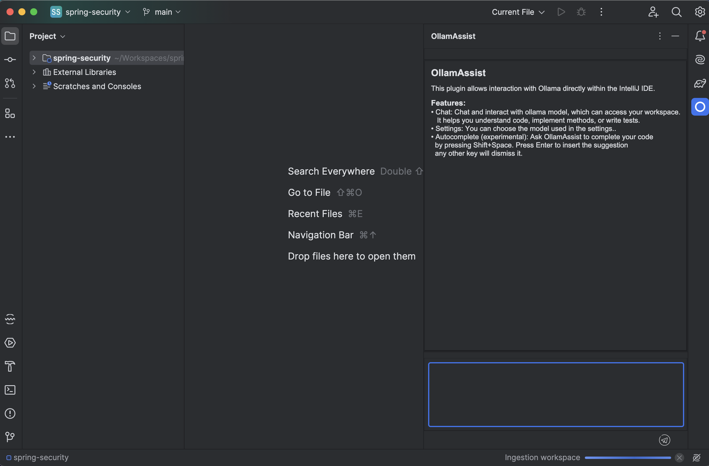
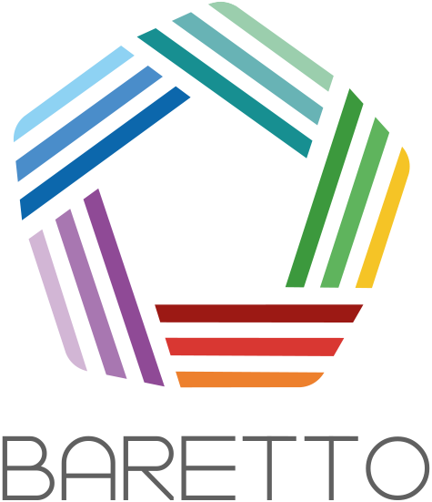

<div class="abs-tr mt-14 mr-16 coup-de-tampon">
  <Tampon :angle="10">Copie à corriger</Tampon>
</div>

# RAGots et <span class="rouge">Hallucinations</span>

<p class="sous-titre">votre chatbot <span class="entoure">passe devant le juge</span></p>

<p class="mt-10 flex items-center">
  <a href="https://fr.linkedin.com/in/melketroussi" target="_blank" class="inline-flex items-center gap-2">
    <carbon:logo-linkedin class="text-2xl" /> Mehdi Elketroussi
  </a>
  <span class="mx-3 text-gray-400">·</span>
  <a href="https://www.baretto.fr" target="_blank" class="inline-flex items-center gap-2">
     Baretto
  </a>
</p>

<div class="abs-bl ml-18 mb-10">
  <span class="etiquette-logo">
    
    DevFest Paris · 27 novembre 2026
  </span>
</div>

<!--
⏱ 0:10 (0:10). Cible : 18 min max.
- Bonsoir à tous ! Dernier talk de la journée : promis, je vous rends à l'apéro à l'heure.
- (1 s de silence, puis Moffatt. Je me présente à la diapo 5.)
-->

---
transition: fade-out
---
# Jake Moffatt, 2022

<div class="scotch mx-auto w-[92%]">
  
</div>

<p class="ref text-right mt-3">« The Long Lonely Wait », Anne Worner, CC BY-SA 2.0</p>

<!--
⏱ 0:35 (1:05)
- Jake Moffatt, 2022. Un deuil, un voyage en urgence.
- Le chatbot : « achetez votre billet, on vous remboursera une partie à votre retour ».
- Au retour : « c'était une erreur du chatbot ».
-->

---
transition: fade-out
---
# Un chatbot n'est pas un POC

Air Canada plaide : le chatbot est
**« une entité juridique distincte, responsable de ses propres actes »**.

<div v-click>

Le tribunal :

> « It is still just a part of Air Canada's website. »

<span class="ref">Moffatt v. Air Canada, 2024 BCCRT 149</span>

</div>

<div v-click class="abs-br mb-20 mr-20 coup-de-tampon">
  <Tampon :angle="-10">650,88 $ CA</Tampon>
</div>

<!--
⏱ 0:55 (2:00)
- Air Canada : « le chatbot est responsable de ses actes ».
- [click] Le tribunal : il fait partie du site. (laisser lire)
- [click] 650,88 $. (laisser le tampon) Un chatbot n'est pas un POC.
- Mains levées : qui a un LLM en prod ? (2 s) Qui l'évalue ? (2 s, un mot de réaction)
-->

---
transition: fade-out
---
# Même un expert n'a rien vu

<div class="scotch extrait mx-auto mt-8">
  <span class="source">Autre affaire · un avocat, New York, 2023</span>
  <ol class="citations">
    <li>Affaire <b>Varghese</b> <span>2019</span></li>
    <li>Affaire <b>Shaboon</b> <span>2013</span></li>
    <li>Affaire <b>Petersen</b> <span>2012</span></li>
    <li>Affaire <b>Martinez</b> <span>2019</span></li>
    <li>Affaire <b>Durden</b> <span>2017</span></li>
    <li>Affaire <b>Miller</b> <span>1999</span></li>
  </ol>
  <div v-click="1" class="tampon-faux coup-de-tampon"><Tampon :angle="-9" taille="1.5rem">Aucun n'existe</Tampon></div>
</div>

<p v-click="1" class="text-center mt-4"><span class="ref">Mata v. Avianca, 2023</span></p>

<p v-click="2" class="text-center" style="margin-top: 1.5rem"><span class="entoure font-bold">Avec un LLM, le faux a exactement la forme du vrai.</span></p>

<style>
.extrait { position: relative; width: 640px; padding: 1.1rem 2rem; }
.extrait .source {
  font-family: 'JetBrains Mono', monospace; font-size: 0.75rem;
  letter-spacing: 0.05em; color: var(--encre-douce);
}
.extrait .citations { list-style: decimal; padding-left: 1.6rem; margin: 0.8rem 0 0; font-size: 1.35rem; line-height: 1.6; }
.extrait .citations li { margin: 0; padding-left: 0.3rem; }
.extrait .citations li::marker { color: var(--encre-douce); font-size: 1rem; }
.extrait .citations span { font-family: 'JetBrains Mono', monospace; font-size: 0.9rem; color: var(--encre-douce); margin-left: 0.5rem; }
.tampon-faux { position: absolute; right: -2rem; bottom: -0.6rem; }
</style>

<!--
⏱ 1:00 (3:00)
- Autre affaire, New York, 2023 : un avocat dépose ce mémoire. Tout a l'air juste.
- [click] Six jugements, tous inventés par ChatGPT. L'avocat paie 5 000 dollars.
- Test unitaire, comparaison mot à mot : ils ne voient rien.
- [click] « Avec un LLM, le faux a exactement la forme du vrai. »
-->
---
transition: fade-out
---
# OllamAssist
<div class="carte">
<div class="texte">

**Un assistant de code dans IntelliJ,
entièrement local. Mon labo.**

<p v-click>D’abord un <strong>chatbot</strong> : ce qu’il sait.</p>

<p v-click>Puis un <strong>agent</strong> : ce qu’il trouve dans <strong>mon</strong> code.</p>

<p v-click><strong>Sa réponse dépend de ce qu’il a trouvé.</strong></p>

</div>

</div>

<!--
⏱ 0:40 (3:40)
- Moi, c'est Mehdi. Le jour, je suis développeur chez Baretto. Certains soirs, quand mes deux petites princesses dorment… je code OllamAssist. Un assistant de code, en local. Mon labo.
- [click] D'abord un chatbot.
- [click] Puis un agent : il lit mon code.
- [click] RAG : on lui donne des extraits, il répond à partir d'eux.
-->

---
transition: fade-out
---
# Comment savoir si j'améliore mon assistant ?

Deux façons de récupérer les extraits.

<div class="fiches mt-6">
<div class="fiche">
  <strong>Vectoriel : il cherche ce qui ressemble</strong>
</div>
<div class="fiche">
  <strong>Graphe : il suit les liens du code</strong>
  <span class="annotation">sur du code, il devrait gagner</span>
</div>
</div>

<p v-click class="mt-8">J'écris, je choisis, je juge : <strong>rien ne me contredit.</strong></p>

<p v-click><span class="entoure font-bold">Il me faut un autre juge.</span></p>

<!--
⏱ 0:45 (4:25)
- Deux façons de récupérer les extraits. Vectoriel : ce qui ressemble à la question. Graphe : il suit les liens du code, comme un Ctrl+clic.
- Sur du code, le graphe devrait gagner. Lequel est meilleur ?
- [click] J'écris, je choisis, je juge : rien ne me contredit.
- Un jour, je reçois une issue GitHub : « le RAG ne fonctionne pas ». Ma réaction : impossible. Mais pour le prouver, je n'avais rien.
- [click] Il me faut un autre juge.
-->

---
layout: center
transition: fade-out
---

<Exercices :courant="1" />

<!--
⏱ 0:05 (4:30)
- Trois exercices. Mon RAG répond, un autre LLM le juge. Exercice 1 : le principe.
-->

---
transition: fade-out
---
# LLM-as-a-Judge

<JugeTheorie />

<!--
⏱ 1:40 (6:10)
- [click] Une question de la copie : son contexte, la réponse de mon assistant.
- [click] Un LLM qui ne rédige pas : il la lit.
- [click] Il rend un verdict.
- [click] Barème : des cases à cocher, écrites avant. Rien hors contexte, même vrai.
- Les six arrêts de l'avocat ? Recalés dès la case 1.
- [click] Filtre sans LLM : chez moi, ça compile ? Sinon, inutile de le lire.
- [click] Format imposé : il coche les critères, il tranche, il donne sa raison. Sinon, il bavarde.
-->
---
transition: fade-out
---
# Rapide à coder ... 

<div class="code-juge">

```java {7-9}
ChatModel juge = OllamaChatModel.builder()
    .baseUrl("http://localhost:11434")
    .modelName("qwen2.5-coder:32b")
    .temperature(0.2)
    .build();

ChatResponse r = juge.chat(
    SystemMessage.from(BAREME),  // le barème + les règles
    UserMessage.from(question + contexte + reponse));

// { critères, verdict, raison }
Judgement j = parse(r.aiMessage().text());
```

</div>

<style>
.code-juge .slidev-code { font-size: 1.25rem !important; line-height: 1.45 !important; }
.code-juge .slidev-code .slidev-code-dishonored { opacity: 0.6; }
</style>

<!--
⏱ 0:40 (6:50)
- Dix lignes de LangChain4j.
- Facile à coder. Mais un LLM a des biais.
-->
---
transition: fade-out
---
# Quelques biais des LLM ...

<ul class="biais">
  <li><strong>Indulgence</strong> : il valide trop facilement ?</li>
  <li><strong>Verbosité</strong> : le long l'impressionne ?</li>
</ul>

<p v-click class="mt-12"><span class="entoure font-bold">Pour le savoir, il me faut une copie test.</span></p>

<style>
.biais { margin-top: 2.5rem; font-size: 1.4rem; line-height: 1.5; }
.biais li { margin-bottom: 1.6rem; }
</style>

<!--
⏱ 0:40 (7:30)
- Indulgence : il laisse passer le faible ?
- Verbosité : le long l'impressionne ?
- [click] Pour le savoir, il me faut une copie test : des questions dont je connais déjà le verdict.
-->

---
layout: center
transition: fade-out
---

<Exercices :courant="2" />

<!--
⏱ 0:05 (7:35)
- Exercice 2 : j'étalonne mon juge, avec une copie test.
-->

---
transition: fade-out
---
# Qui juge le juge ?

50 questions dont je connais le verdict.

<div class="etalon mt-3">
<div class="pieges">
  <div v-click="1" class="lecon">
    <span class="etiquette">piège · indulgence</span>
    <div class="chiffre">27 <small>fausses</small></div>
    <p>Toujours «&nbsp;oui&nbsp;» : 46&nbsp;%</p>
  </div>
  <div v-click="2" class="lecon">
    <span class="etiquette">piège · verbosité</span>
    <div class="chiffre">11 <small>longues</small></div>
    <p>dont 8 fausses</p>
  </div>
</div>
<div v-click="3" class="scotch copie-test">
  <div class="entete"><span></span><span>moi</span><span>mon juge</span><span></span></div>
  <div class="q"><span>Question 1</span><span class="ok">✓</span><span class="ok">✓</span><span class="egal">=</span></div>
  <div class="q"><span>Question 2</span><span class="ko">✗ faux</span><span class="ok">✓</span><span class="diff">≠</span></div>
  <div v-click="4" class="detail">
    <p class="enonce">« Liste en lecture seule » : <code>Arrays.asList(…)</code>, « liste immuable »</p>
    <div class="avis"><span class="qui">moi</span><span class="ko">✗ exact ✗ bugs ✗ consigne</span><span class="raison">« taille fixe, pas immuable »</span></div>
    <div class="avis"><span class="qui">mon juge</span><span class="ok">✓ exact ✓ bugs ✓ consigne</span><span class="raison">« une liste immuable »</span></div>
  </div>
  <div class="q"><span>…</span><span></span><span></span><span></span></div>
  <div class="q"><span>Question 50</span><span class="ok">✓</span><span class="ok">✓</span><span class="egal">=</span></div>
</div>
</div>

<p v-click="5" class="mt-4"><span class="entoure font-bold">Avant d'écrire le juge, écris ta copie test.</span></p>

<style>
.etalon { display: grid; grid-template-columns: 1fr 2.1fr; gap: 2rem; align-items: start; }
.copie-test .detail.slidev-vclick-hidden { display: none; }
.copie-test .detail { padding: 0.5rem 0 0.6rem; border-bottom: 1px dashed rgba(28, 37, 65, 0.18); }
.copie-test .detail .enonce { margin: 0 0 0.4rem; font-size: 0.95rem; }
.copie-test .detail .avis { display: grid; grid-template-columns: 5rem auto 1fr; gap: 0.8rem; align-items: baseline; font-size: 0.9rem; }
.copie-test .detail .qui { font-family: 'JetBrains Mono', monospace; font-size: 0.7rem; letter-spacing: 0.1em; text-transform: uppercase; color: var(--encre-douce); }
.copie-test .detail .raison { font-family: 'Caveat', cursive; font-size: 1.25rem; color: var(--encre); white-space: nowrap; }
.copie-test { padding: 0.7rem 1.3rem 0.5rem; }
.copie-test .entete, .copie-test .q {
  display: grid; grid-template-columns: 1fr 7.5rem 5.5rem 2rem; align-items: center;
}
.copie-test .entete {
  font-family: 'JetBrains Mono', monospace; font-size: 0.75rem; letter-spacing: 0.12em;
  text-transform: uppercase; color: var(--encre-douce); padding-bottom: 0.3rem;
}
.copie-test .q { font-size: 1rem; padding: 0.2rem 0; border-bottom: 1px dashed rgba(28, 37, 65, 0.18); }
.copie-test .ok { color: var(--vert); font-weight: 700; }
.copie-test .ko { color: var(--rouge); font-weight: 700; }
.copie-test .egal { color: var(--encre-douce); font-weight: 700; text-align: center; }
.copie-test .diff { color: var(--rouge); font-weight: 800; text-align: center; }
.pieges { display: flex; flex-direction: column; gap: 1.4rem; }
.pieges .chiffre { font-size: 2.2rem; }
.pieges p { font-size: 0.9rem; line-height: 1.35; margin: 0; }
</style>

<!--
⏱ 1:15 (8:50)
- Qui juge le juge ? Moi. Ma copie test : 50 questions dont je connais le verdict. Je l'ai écrite pour piéger les deux biais.
- [click] Indulgence : 27 fausses sur 50. Un juge qui dit toujours oui : 46 %.
- [click] Verbosité : 11 longues, dont 8 fausses. S'il aime le long, il tombe.
- [click] Mon juge corrige la même copie. Je compare question par question : sa note, c'est le % de questions où il tranche comme moi. Les mêmes verdicts, aux mêmes questions. Question 1 : d'accord. Question 2 : pas d'accord.
- [click] Question 2 : une liste en lecture seule. La réponse : « Arrays.asList, c'est une liste immuable ».
- Faux : taille fixe. Pas d'ajout, pas de suppression… mais set() passe.
- Moi : faux. Mon juge : trois cases vertes, et il écrit « une liste immuable ». (1 s)
- Il a cru la réponse. Tout se joue sur un mot. C'est ça, l'indulgence.
- [click] Avant d'écrire le juge, écris ta copie test.
- Aujourd'hui, je fixerais aussi un score minimum avant de commencer, par exemple 85 %. Je ne l'avais pas fait.
-->

---
layout: center
class: text-center
transition: fade-out
---

<h1 class="titre-seuil">Une mesure a une marge d'erreur</h1>

<div class="seuils mt-10">
  <span class="n">50 questions</span><span class="fleche">→</span><strong>seuil : 14 points</strong><span class="annotation">ma copie test</span>
  <span v-click class="n">100 questions</span><span v-click="1" class="fleche">→</span><strong v-click="1">seuil : 10 points</strong><span></span>
</div>

<p class="mt-10"><span class="ref">ça se calcule : test de McNemar</span></p>

<style>
.slidev-layout h1.titre-seuil { font-size: 2.6rem; }
.seuils { display: grid; grid-template-columns: auto auto auto auto; gap: 1.2rem 1.5rem; justify-content: center; align-items: baseline; text-align: left; font-size: 1.6rem; }
.seuils .fleche { color: var(--encre-douce); }
.seuils .annotation { font-size: 1.5rem; }
</style>

<!--
⏱ 0:15 (9:05)
- C'est comme un sondage : un petit écart peut venir du hasard.
- Avec mes 50 questions, il faut au moins 14 points d'écart : 7 questions.
- [click] Avec 100 questions, 10 points. Plus j'ai de questions, plus je vois les petits écarts.
- Ça se calcule : test de McNemar. Sujet critique, médical ou juridique : il faut plus de questions.
-->


---
transition: fade-out
---
# Mon juge ne rend pas de verdict

Premier prompt : rien d'exploitable.

<div class="grid gap-10 mt-8 items-center" style="grid-template-columns: auto 1fr">
<div class="lecon items-center text-center">
  <span class="etiquette">mon juge · Qwen 14B</span>
  <div class="chiffre grand whitespace-nowrap"><span class="zero">0 %<span v-click="1" class="trait"></span></span><span v-click="1"> → 76 %</span></div>
  <p>d'accord avec moi sur les 50 questions</p>
</div>
<div v-click="1" class="regles">
  <span class="etiquette">4 règles ajoutées au barème</span>
  <p><em>par exemple :</em> une seule case rouge, la réponse est recalée.</p>
</div>
</div>

<p v-click="2" class="mt-8 text-center"><span class="entoure font-bold">Le plus gros levier m'a coûté quatre règles.</span></p>

<style>
.zero { position: relative; }
.zero .trait {
  position: absolute; left: -0.1em; right: -0.1em; top: 52%;
  height: 0.12em; background: var(--rouge); rotate: -8deg;
}
.regles { text-align: left; }
.regles .etiquette { font-size: 1rem; }
.regles p { font-size: 1.4rem; line-height: 1.4; margin-top: 0.6rem; }
</style>

<!--
⏱ 1:00 (10:05)
- 50 questions, il n'en juge aucune : 0 %. Pas faux : illisible. Il s'arrête avant le verdict.
- [click] J'ajoute quatre règles au barème, des règles de notation. Par exemple : une seule case rouge, et la réponse est recalée. Même modèle, Qwen 14B : 76 %.
- [click] Le plus gros levier : quatre règles.
- Ma copie test me montre qu'il est indulgent : 10 mauvaises réponses sur 27 passent.
-->

---
transition: fade-out
---
# Trois pistes

Mon juge fait 76 %. Comment monter ?

<div class="bulletin mt-4">
  <div v-click="1" class="ligne">
    <span class="candidat">J'entraîne</span>
    <span class="note">76 → 76 %</span>
    <span v-click="2"><Tampon couleur="encre" taille="0.9rem" :angle="3">rien gagné</Tampon></span>
    <span v-click="2" class="annotation faute" style="grid-column: 1 / -1">le format, pas le jugement</span>
  </div>
  <div v-click="3" class="ligne">
    <span class="candidat">Je prends plus gros <small>14B → 32B</small></span>
    <span class="note">76 → 90 %</span>
    <span v-click="7"><Tampon couleur="vert" taille="0.9rem" :angle="-4">retenu</Tampon></span>
    <span v-click="4" class="annotation" style="grid-column: 1 / -1; color: var(--vert)">+14 : seuil atteint</span>
  </div>
  <div v-click="5" class="ligne">
    <span class="candidat">Un jury <small>Qwen 32B, Mistral 24B, Gemma 31B</small></span>
    <span class="note">90 → 94 %</span>
    <span v-click="6"><Tampon couleur="rouge" taille="0.9rem" :angle="3">pas rentable</Tampon></span>
    <span v-click="6" class="annotation faute" style="grid-column: 1 / -1">+4 : sous le seuil</span>
  </div>
</div>

<p v-click="8" class="mt-6"><span class="entoure font-bold">Mon juge est retenu : Qwen 32B.</span></p>

<!--
⏱ 1:15 (11:20)
- 76 %. Comment monter ? Une phrase par clic.
- [click] J'entraîne, sur le MacBook : rien ne bouge.
- [click] Il apprend le format, pas le jugement : rien gagné.
- [click] Plus gros, 32 milliards : 90 %.
- [click] +14, soit 7 questions de plus : il atteint le seuil.
- [click] Un jury de trois familles, Qwen, Mistral et Gemma : 94 %, c'est le plus haut.
- [click] Mais +4, c'est 2 questions : sous le seuil. Et je paie trois modèles. Le 32B, c'est un seul modèle, et les fausses qui passent tombent de 10 à 4.
- [click] Le plus gros est retenu : il tourne sur mon poste.
- [click] Mon juge est retenu : Qwen 32B. L'instrument est prêt.
- Je ne le sais que grâce à ma copie test. Pour mon labo, 50 questions suffisent. Pour un chatbot qui engage la compagnie, il en faut beaucoup plus.
-->

---
transition: fade-out
---
# Quand mon juge hésite

Je le relance trois fois sur chaque question.

<div class="routage mt-8">
  <div class="boite depart pile">Mon juge</div>
  <svg v-click="1" class="fourche haut" viewBox="0 0 100 100" preserveAspectRatio="none"><path d="M0,100 L30,100 L30,50 L100,50" /></svg>
  <svg v-click="2" class="fourche bas" viewBox="0 0 100 100" preserveAspectRatio="none"><path d="M0,0 L30,0 L30,50 L100,50" /></svg>
  <div v-click="1" class="branche haut"><span class="compte">4</span><span class="votes"><i class="ok">✓</i> <i class="ko">✗</i> <i class="ok">✓</i></span>il change d'avis</div>
  <div v-click="1" class="cible haut">→ <span class="boite">je relis</span></div>
  <div v-click="2" class="branche bas"><span class="compte">46</span><span class="votes"><i class="ok">✓</i> <i class="ok">✓</i> <i class="ok">✓</i></span><span class="ou">ou</span><span class="votes"><i class="ko">✗</i> <i class="ko">✗</i> <i class="ko">✗</i></span>même avis</div>
  <div v-click="2" class="cible bas">→ <span class="boite">verdict direct</span></div>
  <div v-click="3" class="issue haut vert">→ 2 erreurs attrapées</div>
  <div v-click="3" class="issue bas rouge">→ 3 erreurs passent<span class="annotation faute">ses angles morts</span></div>
</div>

<p v-click="4" class="mt-10"><span class="entoure font-bold">Ne relis que les doutes.</span></p>

<style>
.routage {
  display: grid;
  grid-template-columns: auto 2.2rem auto auto 1fr;
  grid-template-rows: 6rem 6rem;
  align-items: center; column-gap: 0.6rem; font-size: 1.05rem;
}
.routage .boite {
  border: 2px solid var(--encre); border-radius: 6px; padding: 0.35rem 0.8rem;
  background: var(--papier-carte); font-weight: 600; white-space: nowrap;
}
.routage .depart { grid-row: 1 / 3; }
.routage .pile {
  margin: 12px 12px 0 0;
  box-shadow: 6px -6px 0 -2px var(--papier-carte), 6px -6px 0 0 var(--encre),
              12px -12px 0 -2px var(--papier-carte), 12px -12px 0 0 var(--encre);
}
.routage .votes { display: inline-block; margin: 0 0.5rem 0 0.3rem; padding: 0.1rem 0.3rem; border: 1.5px solid var(--encre-douce); border-radius: 4px; font-size: 0.95rem; font-weight: 700; letter-spacing: 0.05em; color: var(--encre); }
.routage .votes i { font-style: normal; }
.routage .ou { margin: 0 0.3rem 0 -0.2rem; font-size: 0.95rem; color: var(--encre-douce); }
.routage .votes .ok { color: var(--vert); }
.routage .votes .ko { color: var(--rouge); }
.routage .fourche { grid-column: 2; width: 100%; height: 100%; overflow: visible; }
.routage .fourche path { fill: none; stroke: var(--encre); stroke-width: 2; vector-effect: non-scaling-stroke; }
.routage .haut { grid-row: 1; }
.routage .bas { grid-row: 2; }
.routage .branche { grid-column: 3; white-space: nowrap; }
.routage .compte { display: inline-block; min-width: 2.4rem; text-align: right; font-size: 1.9rem; font-weight: 800; margin-right: 0.3rem; }
.routage .cible { grid-column: 4; white-space: nowrap; }
.routage .issue { grid-column: 5; font-weight: 700; white-space: nowrap; position: relative; }
.routage .issue.vert { color: var(--vert); }
.routage .issue.rouge { color: var(--rouge); }
.routage .issue .annotation { position: absolute; left: 1.4rem; top: 1.9rem; font-weight: 400; }
</style>


<!--
⏱ 0:45 (12:05)
- Mon juge est retenu. Dernière chose sur ma copie test : où il hésite. Je le relance trois fois sur chaque question.
- [click] Là où il change d'avis, il hésite : 4 questions sur 50, mesuré sur ma copie test. Celles-là, je les relis.
- Trois passes, ça coûte aussi. Mais là, je sais ce que j'achète : 4 relectures au lieu de 50.
- [click] Les 46 autres, même avis trois fois : verdict direct, je ne les relis pas.
- [click] Sur ses 5 erreurs, 2 tombent dans mes relectures : attrapées. Les 3 autres, il les répète : ce sont ses angles morts.
- [click] Ne relis que les doutes.
-->

---
layout: center
transition: fade-out
---

<Exercices :courant="3" />

<!--
⏱ 0:05 (12:10)
- Exercice 3 : mon juge est retenu. Je le mets au travail sur mon RAG, avec 60 questions.
-->

---
transition: fade-out
---
# Premier verdict

Mon assistant répond à 60 questions.

<div class="barres mt-8">
  <div v-click class="barre-ligne">
    <span>GraphRAG <small>Neo4j</small></span>
    <div class="piste"><div class="plein rouge" style="--v: 16.7"></div></div>
    <strong>10 / 60</strong>
  </div>
  <div v-click class="barre-ligne">
    <span>Vectoriel <small>Lucene</small></span>
    <div class="piste"><div class="plein" style="--v: 60"></div></div>
    <strong>36 / 60</strong>
  </div>
</div>

<div v-click class="mt-8">
  <p><span class="annotation faute">un écart pareil ? c’est mon code</span></p>
  <p class="mt-4"><span class="entoure font-bold">Mon juge a trouvé un bug dans mon RAG.</span></p>
</div>


<!--
⏱ 1:00 (13:10)
- Alors, j'améliore ?
- Mon juge corrige les 60 questions de mon assistant : il compte les contextes suffisants.
- [click] Graphe : 10 contextes suffisants sur 60.
- [click] Vectoriel : 36 sur 60.
- [click] Un tel écart, c'est mon code : le graphe perd des liens. Il ramène la classe, pas ce qu'elle implémente.
- Je m'attendais à l'inverse.
- En mesurant, mon juge a trouvé un bug dans mon RAG. Je l'ai trouvé en lisant ses raisons.
- L'issue GitHub avait raison. (1 s)
-->

---
transition: fade-out
---
# Une autre piste

Vectoriel + mots-clés (BM25)

<div class="barres mt-8">
  <div class="barre-ligne deja">
    <span>GraphRAG <small>Neo4j</small></span>
    <div class="piste"><div class="plein rouge" style="--v: 16.7"></div></div>
    <strong>10 / 60</strong>
  </div>
  <div class="barre-ligne">
    <span>Vectoriel <small>Lucene</small></span>
    <div class="piste"><div class="plein" style="--v: 60"></div></div>
    <strong>36 / 60</strong>
  </div>
  <div v-click class="barre-ligne">
    <span>Vectoriel + BM25 <small>Lucene</small></span>
    <div class="piste"><div class="plein vert" style="--v: 78.33"></div></div>
    <strong>47 / 60</strong>
  </div>
</div>

<p v-click="1" class="mt-8"><span class="annotation" style="color: var(--vert)">+11 contextes, il en fallait 7</span></p>

<style>
.barre-ligne.deja { opacity: 0.4; }
</style>

<!--
⏱ 0:40 (13:50)
- Corriger le graphe, ça prend du temps. Mais j'ai de quoi mesurer : j'essaie une autre piste. Vectoriel, plus une recherche par mots-clés, BM25.
- [click] Contextes suffisants : 36 contre 47, sur 60. Comme pour le juge : sur 60 questions, moins de 7 d'écart, ça peut être le hasard. Ici, 11.
-->

---
layout: center
class: text-center
transition: fade-out
---

<p class="rappel">Comment savoir si j'améliore mon assistant ?</p>

<h1 class="reponse">Je mesure. Puis je livre.</h1>

<div class="pari mt-10">
  <span class="etiquette">mon pari</span>
  <span class="choix"><span class="pari-nom">GraphRAG<span v-click="1" class="trait"></span></span></span>
  <span v-click="1" class="etiquette">livré</span>
  <span v-click="1" class="choix">Vectoriel + BM25 <Tampon couleur="vert" taille="1rem" :angle="-4">en prod</Tampon></span>
</div>

<style>
.pari { display: grid; grid-template-columns: auto auto; gap: 1rem 2rem; justify-content: center; align-items: center; text-align: left; }
.pari .choix { font-size: 1.8rem; font-weight: 700; display: flex; align-items: center; gap: 1.5rem; }
.pari .pari-nom { position: relative; }
.pari .trait { position: absolute; left: -0.1em; right: -0.1em; top: 52%; height: 0.12em; background: var(--encre); rotate: -6deg; }
.rappel { font-size: 1.3rem; color: var(--encre-douce); margin: 0 0 1.2rem; }
.slidev-layout h1.reponse { font-size: 3.2rem; }
</style>

<!--
⏱ 0:20 (14:10)
- Ma question de départ : comment savoir si j'améliore mon assistant ?
- Maintenant, je mesure. Puis je livre.
- Mon pari, c'était le graphe, tel que je l'avais codé.
- [click] La mesure m'a fait livrer autre chose : vectoriel + BM25. En prod le jour même, et je sais que c'est mieux.
-->

---
layout: center
class: text-center
transition: fade-out
---

<CopieCorrigee />

<!--
⏱ 1:00 (15:10)
- Pour chaque règle : je la lis, je lis l'annotation, je clique.
- [click] Écris ta copie test d'abord.
- [click] Écris ton barème.
- [click] Ne relis que les doutes.
- [click] « Lis les raisons de ton juge. » C'est en les lisant que j'ai trouvé mon bug.
- [click] Dernière phrase : « Tôt ou tard, votre chatbot sera jugé. Choisissez quand. »
- 2 s de silence. Puis « Merci ».
-->


---
transition: fade-out
---
# Les sources

<div class="sources sources-qr mt-6">
<div>
  <span class="etiquette">le code</span>
  <p><a href="https://github.com/baretto-labs/OllamAssist" target="_blank"><b>OllamAssist</b></a><br><span class="ref">github.com/baretto-labs/OllamAssist</span></p>
  <p><a href="https://github.com/baretto-labs/llm-as-a-judge" target="_blank"><b>Le juge et le script de mesure</b></a><br><span class="ref">github.com/baretto-labs/llm-as-a-judge</span></p>
  <span class="etiquette mt-5 block">les affaires</span>
  <p><a href="https://www.canlii.org/en/bc/bccrt/doc/2024/2024bccrt149/2024bccrt149.html" target="_blank"><b>Moffatt v. Air Canada</b></a><br><span class="ref">2024 BCCRT 149</span></p>
  <p><a href="https://storage.courtlistener.com/recap/gov.uscourts.nysd.575368/gov.uscourts.nysd.575368.54.0_1.pdf" target="_blank"><b>Mata v. Avianca</b></a><br><span class="ref">S.D.N.Y. · 2023</span></p>
  <span class="etiquette mt-5 block">le seuil</span>
  <p><a href="https://doi.org/10.1162/089976698300017197" target="_blank"><b>McNemar</b></a><br><span class="ref">Dietterich · 1998</span></p>
</div>
<div class="qr-centre">
  <div class="scotch"><a href="https://github.com/baretto-labs/llm-as-a-judge" target="_blank"></a></div>
  <span class="annotation">le repo</span>
</div>
<div>
  <span class="etiquette">les articles</span>
  <p><a href="https://hamel.dev/blog/posts/llm-judge/" target="_blank"><b>Using LLM-as-a-Judge</b></a><br><span class="ref">Hamel Husain · hamel.dev</span></p>
  <p><a href="https://arxiv.org/abs/2306.05685" target="_blank"><b>Judging LLM-as-a-Judge</b></a><br><span class="ref">Zheng et al. · 2023</span></p>
  <p><a href="https://arxiv.org/abs/2403.18771" target="_blank"><b>CheckEval</b></a><br><span class="ref">Lee et al. · 2024</span></p>
  <p><a href="https://arxiv.org/abs/2303.08896" target="_blank"><b>SelfCheckGPT</b></a><br><span class="ref">Manakul et al. · 2023</span></p>
  <span class="etiquette mt-5 block">le jury</span>
  <p><a href="https://arxiv.org/abs/2404.18796" target="_blank"><b>Replacing Judges with Juries</b></a> <span class="annotation text-base">pour</span><br><span class="ref">Verga et al. · 2024</span></p>
  <p><a href="https://arxiv.org/abs/2605.29800" target="_blank"><b>Nine Judges, Two Effective Votes</b></a> <span class="annotation text-base">contre</span><br><span class="ref">Kohli · 2026</span></p>
</div>
</div>

<style>
.sources-qr { display: grid; grid-template-columns: 1fr auto 1fr; gap: 2.5rem; align-items: center; }
.sources-qr p { font-size: 0.9rem; }
.qr-centre { display: flex; flex-direction: column; align-items: center; gap: 0.6rem; }
.qr-centre img { width: 210px; height: 210px; display: block; }
.qr-centre .annotation { font-size: 1.5rem; }
.sources-qr a { color: inherit; text-decoration: none; border-bottom: 1px dotted var(--encre-douce); }
.sources-qr .scotch a { border: 0; }
</style>

<!--
⏱ 0:15 (15:25)
- Le code, le script de mesure et les articles : tout est ici.
- Le QR code, au centre, mène au repo.
-->

---
layout: center
class: text-center
transition: fade-out
---
# Votre avis

<div class="scotch qr-cadre mx-auto mt-4"><a href="https://openfeedback.io/sBSRvQdfgZv87UJ1Zr8p/2026-11-27/df26-029" target="_blank" style="border: 0; display: block;"></a></div>

<p class="mt-4"><span class="annotation">merci ! des questions ?</span></p>

<div class="abs-br mr-14 mb-10 text-center">
  <a href="https://www.baretto.fr" target="_blank">
    
    <span class="ref">www.baretto.fr</span>
  </a>
</div>

<!--
⏱ 0:15 (15:40)
- Vos questions ?
- Laisser cette diapo pendant les questions.

-->
